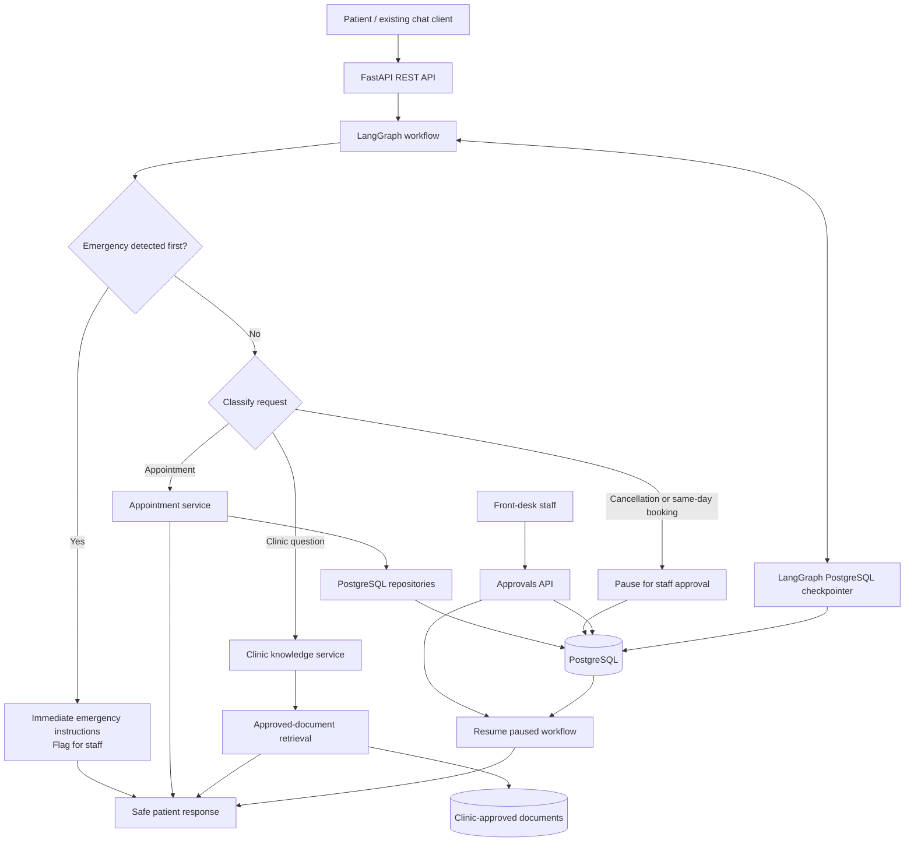

# Clinic Front-Desk Assistant — Backend Architecture

**Status:** Target architecture for the v0.1.0 backend. Some modules are still under development; this document describes their intended responsibilities and contracts.

## Scope and design goals

This repository builds the clinic's backend REST API. The clinic already has a chat client, so this project does not include a website or frontend. The backend uses FastAPI for HTTP, LangGraph for conversation workflows, and PostgreSQL as its only database.

The assistant supports front-desk tasks such as appointment searches, booking requests, staff approvals, and answers grounded in approved clinic information. It must not diagnose patients or recommend treatment.

## System flow

Emergency detection runs before ordinary intent routing. Emergencies receive an immediate safe response and are flagged for staff; they do not enter appointment or retrieval flows. Other requests are routed to the appropriate workflow, and FastAPI returns the resulting response to the chat client.

## Component responsibilities

| Component | Responsibility |
| --- | --- |
| `app/main.py` | Create the FastAPI application, register routers, and initialize pooled PostgreSQL/checkpointer services. |
| `app/api/` | Validate HTTP requests and responses for conversations, appointments, and staff approvals. |
| `app/graphs/` | Define conversation state, detect and route intents, and connect workflow branches. |
| `app/services/` | Implement conversation, appointment, approval, and clinic-knowledge behavior. |
| `app/repositories/` | Persist and retrieve application data with parameterized SQL through psycopg. |
| `app/rag/` | Retrieve relevant material only from clinic-approved documents and provide source metadata. |
| `app/llm.py` | Provide a deterministic fake model for tests and a configurable real-model adapter with timeouts. |
| `app/config.py` | Validate application, database, model, and document-directory settings. |
| `app/db/` | Define application tables, development seed data, database initialization, and LangGraph checkpoint setup. |
| `data/clinic_documents/` | Hold clinic-approved information only; never store patient records here. |

## Shared contracts and persistence

- **Conversation identity:** The API conversation ID must consistently identify the LangGraph thread. The graph uses that stable thread ID when saving and resuming checkpoints.
- **Caller identity:** Conversation and appointment routes derive owner references from trusted host authentication context, never from request bodies. Staff approval routes require a separate trusted staff context. Hosts provide these resolvers when composing the application; requests fail closed when context is absent.
- **Idempotency:** Conversation creation and message/appointment actions require UUID `Idempotency-Key` headers. Retrying a booking or approval with the same key reuses the durable result.
- **Workflow state:** The team agrees on shared fields for recent bounded message history, intent, requested appointment slot, and approval status before connecting graph branches.
- **Database:** PostgreSQL is the only database. Use psycopg with parameterized SQL; do not add an ORM.
- **Appointment safety:** Booking must be atomic and database-backed. A database constraint must reject competing requests for an already-reserved slot, including simultaneous requests.
- **Checkpoints:** LangGraph's PostgreSQL checkpointer stores workflow state so a conversation or pending approval can be restored after a process/container restart. Initialize its tables using the checkpointer's supported setup/migrations rather than duplicating its internal schema.
- **Approvals:** Same-day bookings and cancellations pause for staff decisions. The approval record and graph checkpoint must persist together sufficiently to resume the correct conversation after a restart.
- **Seed data:** Fictional providers and slots are development fixtures only. The initializer must not load them outside `APP_ENV=development`.

## Safety and reliability

1. Never diagnose or recommend treatment.
2. Detect emergencies first and return immediate emergency instructions; do not route them through normal booking or retrieval.
3. Answer clinic-information questions only from approved documents. Include source names and use an honest fallback when evidence is missing.
4. Use the deterministic fake LLM in CI. Real model calls must have a timeout, and model/database failures must not expose secrets or produce invented clinical facts.
5. Keep credentials in environment variables or a local, uncommitted `.env` file. Never commit real secrets or patient data.

## Configuration, deployment, and testing

- Configure the service through validated environment variables documented in `.env.example`.
- The intended fresh-clone workflow starts the backend and PostgreSQL with Docker Compose; database schema and checkpoint initialization run before workflows need them.
- Test services and repositories independently, then cover API and cross-module workflows with unit, API, database, and integration tests.
- CI should run Ruff lint/format checks, mypy, and pytest, with the project coverage target of at least 80%.
- Record research findings in `docs/research/` and lasting design decisions in `docs/adr/`.
